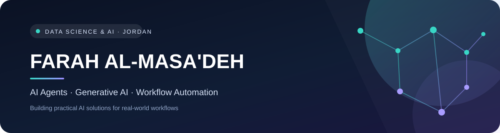

  
  
  
  

### Data Science & AI Graduate · AI Agents · Workflow Automation

*I build practical AI-powered workflows and explore how intelligent systems can solve real-world problems.*

---

## 👋 About Me

I'm a **Data Science & AI graduate** from **Al-Hussein Bin Talal University**, based in Aqaba, Jordan.

My work focuses on building practical solutions with **AI agents, multi-agent workflows, Generative AI, and n8n automation**. I enjoy connecting AI capabilities with tools and APIs to streamline business processes, improve information handling, and create useful user experiences.

- 🤖 Building AI agent and multi-agent workflow projects.
- ⚙️ Designing automations and API integrations with **n8n**.
- 👁️ Interested in computer vision and assistive AI.
- 🌱 Continuously learning, experimenting, and documenting what I build.

---

## 🚀 Featured Projects

A selection of projects across AI agents, workflow automation, and assistive AI. Each repository includes its own scope, setup notes, and current limitations.

| Project | What it explores | Technologies |
|---|---|---|
| [**Dobi Kitchen — Multi-Agent Assistant**](https://github.com/FY0499/Dobi-Kitchen-Multi-Agent-Assistant) | Routes food-business customer requests to specialist paths for order, cancellation, and delivery support. | n8n · AI Agents · Telegram |
| [**Multi-Agent Management Orchestrator**](https://github.com/FY0499/Multi-Agent-Management-Orchestrator) | Coordinates specialist agents to prepare management insights and recommendations. | n8n · Multi-Agent Design · Telegram |
| [**Smart Vision System**](https://github.com/FY0499/blind) | Explores object detection, OCR, relative depth estimation, and Arabic audio guidance for assistive scenarios. | Python · OpenCV · Google Cloud Vision · MiDaS |
| [**Sign-to-Text**](https://github.com/FY0499/Sign-to-Text) | Experimental video-analysis pipeline using hand/face landmarks and model-assisted interpretation. | Python · MediaPipe · OpenCV · Gemini |
| [**Text-to-Sign-Language**](https://github.com/FY0499/Text-to-Sign-Language) | Assembles sign-language video clips from text using a sign dictionary and video processing. | Python · MoviePy · JSON |
| [**AI Travel Planner**](https://github.com/FY0499/AI-Travel-Planner) | Workflow concept for collecting trip preferences and preparing an itinerary with external data. | n8n · AI · API Integrations |

> **Project maturity:** These repositories have different implementation and testing levels. Some are prototypes or workflow concepts and may require additional configuration and end-to-end validation. Check each repository's README for the current status before using or evaluating it.

---

## 🧰 Technologies & Tools

**AI, LLMs & Agent Workflows**

**Automation & Integration**

**Programming & Computer Vision**

**Tools**

---

## 💡 Areas of Interest

مجالات أتابعها وأهتم بالتوسع فيها، ولا أدرجها هنا باعتبارها خبرة عملية مستقلة:

- Generative AI — الذكاء الاصطناعي التوليدي.

---

## 📚 Currently Learning

I'm at the beginning of learning these technologies and currently building foundational knowledge. They are learning goals, not skills or tools I am claiming professional proficiency in yet.

| Technology | Learning stage |
|---|---|
| **LangChain** | Beginner — learning the fundamentals |
| **LangGraph** | Beginner — exploring graph-based agent workflows |
| **LlamaIndex** | Beginner — learning the core concepts |
| **TypeScript** | Beginner — learning the language fundamentals |

I’ll move a technology into my main skills section only after I have used it in practical work.

---

## 📊 GitHub Snapshot

 

---

## 🤝 Let's Connect

I'm interested in connecting with people working in **AI, agentic systems, and workflow automation**, sharing ideas, and learning through practical projects.

- **LinkedIn:** [farah-almasaadeh](https://www.linkedin.com/in/farah-almasaadeh-a92a7b266)
- **Portfolio:** [Explore my projects](https://fy0499.github.io/FY0499/portfolio/)
- **GitHub:** [@FY0499](https://github.com/FY0499)

*Building, learning, and turning ideas into practical AI solutions.*

